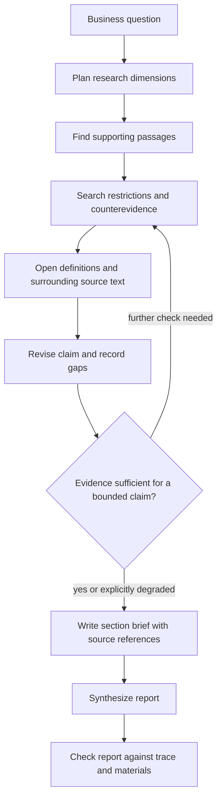

A sales page says an insurance product can be renewed until age 100. A retrieval system finds the sentence, and the generated report repeats it. The answer has a citation. It can still mislead the reader.

The formal terms may say renewal requires an application and the insurer's approval. That condition changes what the report can claim. The task is to find evidence that changes the conclusion, including evidence that is less similar to the original question.

This illustrative example follows the design proposed in the Chinese article; it does not describe a particular policy or a measured production run.

## The missing condition changes the answer

| Material | What it supports | What it does not establish |
| --- | --- | --- |
| Sales page: renewable until age 100 | An advertised upper renewal age | Guaranteed renewal |
| Terms: renewal after application and insurer approval | A conditional renewal process | An unconditional obligation to accept renewal |
| No explicit guaranteed-renewal provision found in the inspected materials | A gap in the evidence reviewed | Proof that no such provision exists anywhere |

A single retrieve-then-generate pass can stop after the first row. The research run needs to ask what could weaken that apparent promise.

```text
Initial question: Can the report say renewal is guaranteed until age 100?

Supporting search:
  renewal age, continuation of coverage

Limiting search:
  renewal application, insurer approval, renewal conditions

Adversarial search:
  discontinuation, termination, right to decline, exclusions

Source reading:
  open the clause, its definitions, and surrounding paragraphs

Revised writing constraint:
  describe the advertised age together with the approval condition;
  do not upgrade the claim to guaranteed renewal.
```

The search terms are not interchangeable. Some find the promise. Others find who retains discretion over it.

## Preserve why each passage was collected

A bundle of relevant passages loses the reason those passages were collected. A writer receiving only the bundle may pick the most fluent sentence and discard the awkward qualification.

A research trace preserves the working question, initial claim, subsequent checks, limiting evidence, unresolved gaps, and the resulting writing constraint. One possible context format is:

```yaml
question: Can renewal be described as guaranteed until age 100?
initial_claim: The sales page advertises renewal until age 100.
support:
  - source: sales-page
    passage: Renewable until age 100.
follow_up_searches:
  - renewal application
  - insurer approval
  - product discontinuation
limits:
  - source: policy-terms
    passage: Renewal requires an application and insurer approval.
evidence_gaps:
  - No explicit guarantee found in the inspected materials.
writing_constraint: >-
  Do not describe renewal as guaranteed. Explain the approval
  condition and identify any unresolved evidence gap.
```

In an implementation, source references need stable document identities and locations so that a verifier can reopen them. The source labels above are placeholders.

An inspected document that was rejected can also matter. Recording why it did not support the claim makes it harder for a later synthesis step to quietly reintroduce it.

## Put the search plan before the prose outline

The report outline alone does not tell an Agent what to investigate. A heading such as “coverage” invites a summary of benefits. A research task for that heading should also require exclusions, hospital definitions, waiting periods, deductibles, and claim conditions.



The feedback edge needs a budget and a stopping policy in a service. More searches are not automatically better. If a required source is absent, the useful result may be a documented gap rather than another paraphrase of the same page.

The proposed architecture assigns planning, search, reading, context organization, and writing with critique. A single tool-using loop can perform several of these jobs; separate contexts help when stages begin to distract one another.

The planner turns the business objective into questions. Search finds candidate passages. Reading establishes which claim each passage supports or restricts. Context organization keeps that relationship intact. The writer consumes section briefs, and the critic checks whether the report preserved what the research discovered.

## Make retrieval and generation failures distinguishable

A report can fail even when every necessary document was retrieved. The writer may omit an exclusion, confuse a sales statement with a contractual commitment, or turn an unresolved gap into a confident conclusion.

| Failure | Evidence to inspect | Likely change |
| --- | --- | --- |
| Relevant limiting clause was never found | Search queries and candidate passages | Improve search plan or retrieval |
| Clause was found but never opened | Tool trace and read operations | Improve navigation and reading policy |
| Clause was read but absent from the brief | Research trace and section brief | Preserve claim-evidence relationships |
| Brief contains the condition, report omits it | Brief versus final report | Fix synthesis and fidelity checks |
| Missing evidence becomes a confident claim | Gap record versus final wording | Enforce degradation in generation and review |

A better embedding model cannot repair a writer that ignores conditions already in its context.

The evaluation should inspect whether the run opened the decisive documents, followed definitions and references, checked plausible counterevidence, and carried the resulting limits into the report. Counting searches or citations alone rewards activity without establishing that the conclusion improved.

## Where this reaches a production boundary

In [[en/program/llm/insurance-report-production|the insurance report production system]], research happens inside a stage whose tools are scoped to one product. The outer graph then enriches the artifact and applies a delivery gate. This gives the research process a concrete input, artifact, and downstream decision.

The runtime must also budget the investigation. Every extra search and verification step consumes time and provider capacity; [[en/program/practices/reliable-agent-systems|the runtime article]] describes those concurrency limits.

The renewal example is a useful acceptance case. If the system still writes “guaranteed renewal until age 100” after reading the approval clause, adding more context has not fixed the failure.

## Research behind the design

[Self-RAG](https://arxiv.org/abs/2310.11511) investigates retrieval and critique through reflection; [Corrective RAG](https://arxiv.org/abs/2401.15884) investigates how to respond to unreliable retrieval. They provide research context for parts of this design. The research trace above is an application design proposal, not a method claimed to be implemented by either paper.
