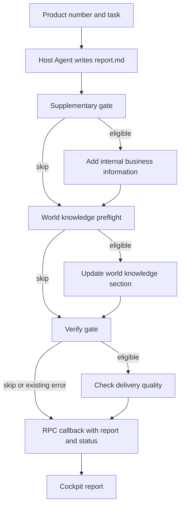

Give the system a product number, `prodNo`, and it has to turn scattered insurance materials into a report someone can use. The inputs include policy clauses, enrollment rules, health disclosures, exclusions, service descriptions, and business data. The report then needs enrichment and a delivery decision. Scoring the report and evaluating the insurance product are separate jobs.

At Ant Group, this led us away from asking one Host Agent to decide the whole production sequence. Agents still search, read, and write inside each stage. A deterministic outer graph decides which stage follows which, what artifact it receives, and how a failed or optional stage affects delivery.

This English account follows the Chinese article revised in August 2026. The diagrams summarize that implementation.

## The change from DIPG to a production graph

An earlier system, the Deep Interpretation Page Generator, produced HTML fragments for a consumer insurance page. Its Host Agent delegated initial generation to a Research Agent, asked a Verify Agent for findings, and patched the HTML itself. That loop could repeat up to five times.

Two failures made the split useful. An orphan `</div>` could break a page's layout. A well-formed page could also claim to outperform 85% of comparable products even though none of the retrieved materials contained market-ranking data. A parser could catch the first problem. The second required comparing the report with the evidence the generator had actually received.

The later report system moved to a stable sequence of generation, internal enrichment, external knowledge alignment, verification, and callback. It removed the automatic repair loop from the main path.



The graph uses these nodes:

```text
host_agent
  -> supplementary_gate -> supplementary_execute
  -> world_knowledge_preflight -> world_knowledge_execute
  -> verify_gate -> verify_execute
  -> callback -> cockpit_report -> END
```

A gate can skip an execution stage. Those decisions belong to graph routing, not to the model's willingness to follow the next instruction. Error status must travel with the artifact; reaching a callback does not itself mean the report passed verification.

## Keep the Host's task small enough to execute

The Host is a domain research Agent built with `AgentBlueprint`, tools, middleware, auditing, and a virtual filesystem. It must learn how to read an unfamiliar product, not memorize a report for every product number.

We considered putting many permanent domain skills into its system prompt: underwriting knowledge, claims knowledge, product judgments, benefit calculations, compliance, and citations. That would make a long research context compete with instructions irrelevant to the current task.

The Host's minimum contract is narrower: read the materials, write `report.md`, preserve citations, degrade when evidence is insufficient, and avoid unsupported claims. Internal business information comes through a Supplementary Agent. Real-world names and public understanding come through a World Knowledge Agent. Quality judgments belong to verification and scoring.

Reading instructions can still vary by insurance type. Medical coverage requires attention to hospital scope, deductibles, reimbursement conditions, renewal, and drugs outside the hospital. Critical-illness coverage needs disease definitions and relationships between benefit conditions. Savings products need cash values and surrender risks. Those differences change the search plan.

## A product boundary belongs in the tools

The original tools were general filesystem operations:

```text
read_disk_file
grep_disk_file
find_disk_files
```

The prompt repeatedly told the Agent to use the material root and avoid unrelated directories. It still forgot the root or searched too broadly.

The replacement made the product scope part of the tool contract:

```text
download(prod_no)
ls_materials(prod_no)
grep_material(prod_no, pattern)
read_material(file_path, prod_no)
find_material(prod_no, pattern)
```

`grep_material` resolves the product's material root itself and returns surrounding lines. `find_material` handles the known directory structure. `read_material` validates the requested path against the product scope, using `realpath` to guard against traversal.

The Agent still chooses what to search for, but the tool fixes which product it can search.

### Search locates evidence; reading establishes what it says

Exact matching alone misses domain synonyms. A question about a payout amount may correspond to wording about benefits, insured sums, or annual limits.

The material index supports a search-then-read path:

```text
Download completes
  -> MaterialIndexMiddleware reads the material manifest
  -> Public clauses and OCR Markdown become chunks
  -> 2,000-character windows, 200-character overlap
  -> Qwen-Embedding-4B embeds chunk bodies
  -> Redis caches vectors
  -> Product-scoped index enters Agent state
  -> semantic_search_material returns candidate chunk IDs
  -> Agent opens and checks the original text
```

The embedding model was tuned on insurance-domain data and shared with another retrieval task. Only the chunk body was embedded, without a product-name, filename, or section-title prefix. We had not established whether that input format was optimal.

The navigation task returned the top five chunk IDs and used `Anchor Precision@5` as its central retrieval metric. Whether the Agent then reads adjacent conditions and produces a faithful report belongs to generator evaluation. A useful retrieval hit is not evidence that the report used it correctly.

If embedding or indexing fails, the search tool returns a degradation notice. The Agent can continue with exact search and source reading. We had not yet analyzed failure cases involving repeated windows, missing heading context, or OCR noise.

## Share the artifact without sharing the whole conversation

The Agents exchange work through `files`, the virtual filesystem in Agent state. The Host writes `report.md`; later Agents use file tools to read or edit it. They do not need the Host's complete conversation history.

| Stage | Receives | May change |
| --- | --- | --- |
| Host | Product materials and generation task | Initial report |
| Supplementary Agent | Internal service and product information | Relevant parts of the existing report |
| World Knowledge Agent | External naming and public understanding | Its designated alignment section |
| Verify Agent | Final report and material state | Verdict, suggestions, and error status |
| Scoring Agent | Restored report and context from a source session | Structured report-quality assessment |
| Product Evaluation Agent | Report, materials, and evaluation criteria | Product-level evaluation |

The World Knowledge stage has an enforced merge boundary. If its update changes sections outside the designated target, the parent graph discards the update and continues with a degraded result. The prompt requests a narrow edit; the parent validates whether that edit stayed narrow.

## Verification stopped being a repair shop

Verification evolved through three versions: direct delivery after generation, fidelity checks with up to five repair attempts, and finally enrichment followed by a quality gate without the retry loop.

The middle version spent expensive Agent calls on corrections and could be derailed by false positives around insurance terminology. More useful questions were being missed: are the core materials present, is degradation honest, and does the report contain enough concrete product parameters to deliver?

The later gate separates fatal failures from suggestions:

```text
Fatal delivery issue -> error_code = "REPORT_QUALITY_POOR"
Nonfatal issue      -> quality_suggestions
```

Missing core policy clauses, severe material insufficiency, or broadly unusable insurance parameters can block delivery. A less polished structure or incomplete citation formatting can become suggestions. Turning every imperfection into an error would trigger downstream failure handling and regeneration for the wrong reasons.

Vague wording needs particular scrutiny. “As specified in the policy” and “paid at a certain proportion” can sound compliant while withholding the parameter the reader came to find. The gate treats such language as missing information when a concrete parameter is required.

A `Gate / Execute` split keeps the cheap decisions outside the model. A gate checks existing errors and whether there is a unique report artifact. Execution performs the judgment that actually needs an Agent.

### Separate loop ownership from model latency

The implementation used distinct loops for the main application, verification, and history queries. The main loop owned the OceanBase pool; verification used an in-memory saver to avoid borrowing that pool across event loops; history queries had their own pool.

An awaited, nonblocking model request does not by itself block an event loop. The operational concerns are blocking work, queue pressure, and resource ownership. A separate loop also does not create extra model capacity. Its in-memory checkpoints do not survive a process restart.

For the underlying lifecycle, see [[en/program/practices/reliable-agent-systems|the runtime architecture and its event-loop boundaries]].

## Delivery, report quality, and product quality are different decisions

A delivery gate answers whether an artifact can proceed. The report-scoring Agent asks how good the report is and what would improve it. It can restore `files` from a source session and run independently of generation.

| Report assessment | Measures |
| --- | --- |
| D1 | Fidelity to source facts |
| D2 | Information completeness |
| D3 | Basic writing quality and consistency |
| Compliance gate | Whether the report crosses a release boundary |

Each checkpoint receives `1.0`, `0.5`, or `0.0`. Application-side Python recomputes aggregate scores instead of trusting model arithmetic. Compliance failure applies a separate penalty rather than disappearing into an ordinary weighted average.

Input depth also limits the score. Basic clauses and enrollment disclosures cannot support the same depth as claims data, underwriting information, or actuarial indicators. A report should not approach full marks merely because it writes fluently around missing inputs.

The Product Evaluation Agent asks a different question: where do the product's indicators sit against supplied baselines and warning thresholds? Criteria vary by insurance category. Without a baseline it makes an objective description, and without data it marks the indicator unevaluable. It must not turn that assessment into a purchase recommendation.

These jobs share artifacts but need not share one long online run. Regenerating an entire report just to rescore it wastes both context and execution time.

## What I would verify before reusing the design

I would exercise a product with missing clauses, an embedding failure, an existing upstream error, and a world-knowledge edit that touches the wrong section. I would also score a report restored from an earlier session and confirm that no generation task runs as a side effect.

A successful report on a fully populated product does not exercise the gates, degradation paths, or merge rejection. Those need their own cases.

The system's unresolved cost is still evidence access. An Agent cannot produce claims-level or actuarial depth from a folder containing only public clauses. In that case, the honest output is a narrower report and a named missing data source.

## Continue in English

- [[en/program/llm/deep-research-context-engineering|Researching evidence that can overturn a claim]] — a worked example of the reading process inside a node.
- [[en/program/practices/reliable-agent-systems|Building a reliable Agent runtime]] — graphs, runs, checkpoints, and resource budgets.
