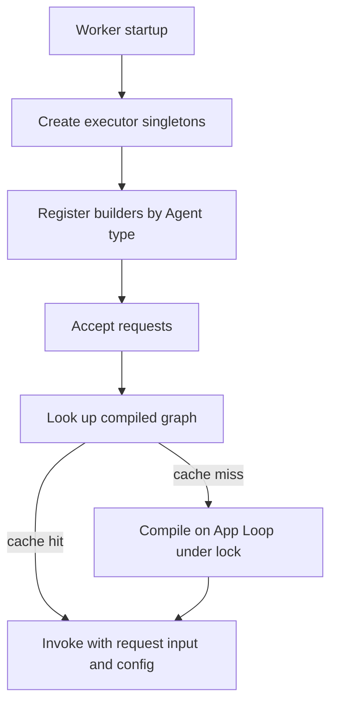
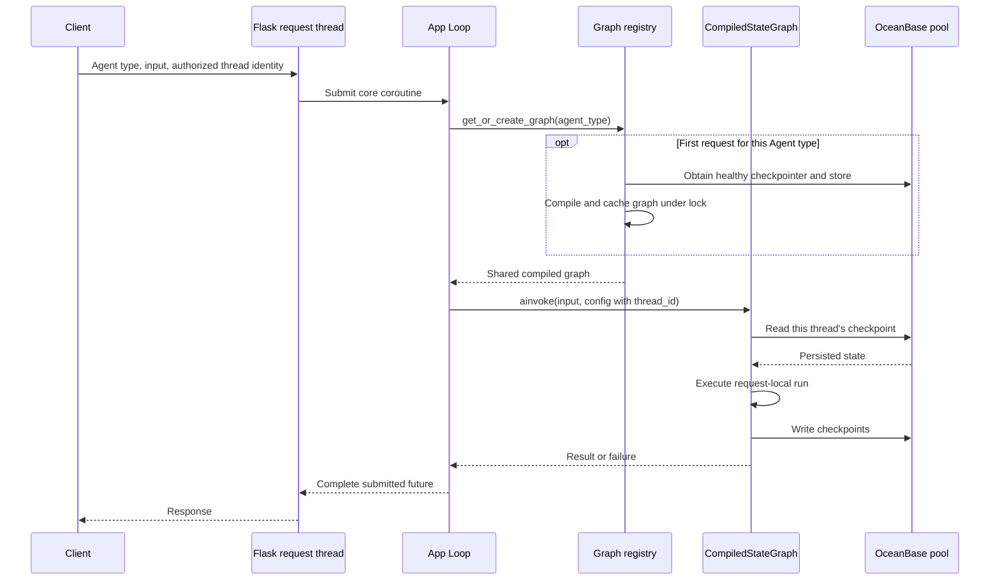

A local Agent script can work perfectly and still fail as soon as two users arrive together. A database connection belongs to the wrong event loop. A node stores the current user on a shared object. A long research run occupies a request thread until the service stops accepting work.

I moved from Java into Python while building Agent applications at Ant Group. This article describes the service architecture I used: Flask-based request handling, a long-lived application event loop, LangGraph execution, and OceanBase persistence through `aiomysql`. The dedicated loop thread bridged the synchronous web server and its async dependencies.

The earlier English version described a session pool that reused an Agent instance for each session. That description was wrong. The reusable object is a process-level `CompiledStateGraph`. Each invocation starts a separate execution; the conversation's persistent state is selected with `thread_id`.

*Originally published in October 2025. This English edition was expanded in October 2026 against the revised Chinese source.*

## One graph, many runs

```python
# Schematic: builder, checkpointer, inputs, and configs are supplied by the app.
graph = builder.compile(checkpointer=checkpointer)

async def request_a():
    return await graph.ainvoke(input_a, {"configurable": {"thread_id": "A"}})

async def request_b():
    return await graph.ainvoke(input_b, {"configurable": {"thread_id": "B"}})

results = await asyncio.gather(request_a(), request_b())
```

Both coroutines reference the same `graph`. Their invocation inputs, execution state, results, exceptions, and cancellation state belong to their respective calls.

```text
Python worker process
├── CompiledStateGraph — shared execution template
├── Coroutine A
│   └── Run A: input A, config A, graph state A, thread_id=A
└── Coroutine B
    └── Run B: input B, config B, graph state B, thread_id=B
```

A new independent task receives a new `thread_id`. Later turns in the same conversation reuse that ID, so the checkpointer can load and extend the same state history. Reusing a graph does not mean reusing another user's conversation.

That distinction also limits the Actor analogy. A long-running Agent resembles an Actor in some ways, but the compiled graph is not a user-specific Actor instance with its own mailbox. The execution and its persistent thread are the closer equivalents.

## Builder, executor, registry

| Component | Owns | Lifetime |
| --- | --- | --- |
| Builder | Domain instructions, tools, nodes, and graph construction | Registered by Agent type |
| Executor | Request adaptation, input/config construction, dispatch to the application loop | Reused within a worker |
| Graph registry | Builder callbacks and compiled graphs indexed by Agent type | One registry per worker process |
| Run | One execution's input, state, output, and failure | One invocation |
| Checkpointer | Graph state snapshots addressed by thread | Persistent state history |
| Store | User preferences and other cross-thread memory | Application-defined retention |

A builder can produce a simple model workflow, a tool-using loop, or a graph containing sub-Agents. The executor calls the same interface in each case.

| Graph interface | Result | Typical caller |
| --- | --- | --- |
| `stream()` | Synchronous iterator | Synchronous streaming integration |
| `astream()` | Async iterator | Interactive output and progress events |
| `invoke()` | Completed result | Synchronous final-result caller |
| `ainvoke()` | Awaitable completed result | Async requests and batch jobs |

In my application, startup discovers `AgentExecutor` subclasses and caches the executors in `EXECUTOR_SINGLETONS`. Each executor registers its `build_agent` callback. The first request for an Agent type compiles the graph on the application loop; later requests reuse it. A lock around first construction prevents concurrent cache misses from compiling duplicate graphs.



Cleaning up expired conversation metadata does not mean closing a user-specific Agent. Graphs, shared clients, and connection pools belong to the worker lifecycle.

## The database pool belongs to one event loop

Using the database pool from the wrong loop can fail with:

```text
got Future ... attached to a different loop
```

Python's GIL is not the explanation for this error. The pool and its asynchronous connections have event-loop ownership. Moving their use between loops breaks that ownership.

The service used `Gunicorn + gthread` because the surrounding SofaApp application was based on Flask. Each worker had request threads plus one long-lived `App Loop` thread. OceanBase connections, the `aiomysql` pool, checkpointers, and stores were created, used, and closed on that loop.

A synchronous request thread submits work with `asyncio.run_coroutine_threadsafe`. An async caller already on the application loop can await the core coroutine directly. The dispatch shape is:

```python
# Schematic adapter: app_loop is already running in another thread.
# _core builds request-local input/config and invokes the cached graph.
async def run_async(self, request):
    if asyncio.get_running_loop() is self.app_loop:
        return await self._core(request)

    future = asyncio.run_coroutine_threadsafe(
        self._core(request), self.app_loop
    )
    return await asyncio.wrap_future(future)


def run_sync(self, request):
    if threading.current_thread() is self.app_loop_thread:
        raise RuntimeError("run_sync must not block the App Loop")

    future = asyncio.run_coroutine_threadsafe(
        self._core(request), self.app_loop
    )
    try:
        return future.result(timeout=self.request_timeout_seconds)
    except concurrent.futures.TimeoutError:
        future.cancel()
        raise
```

This is adapter pseudocode, not a standalone runtime. It assumes `asyncio`, `threading`, and `concurrent.futures` imports and an application-managed loop lifecycle. A wait timeout must propagate cancellation to the submitted work; simply abandoning the waiting thread leaves resource consumption running in the background. Cancellation remains cooperative, and external side effects need their own handling.

A native async server can own the application's long-lived loop directly. The dedicated thread was a bridge for this Flask deployment. Creating a fresh loop with `asyncio.run()` in every request would defeat the shared pool's lifetime.

## Follow a request through persistence



The checkpointer and store solve different problems. Checkpoints preserve a thread's graph state across turns and interruptions. The store holds application data shared across threads, such as user preferences. Neither belongs in a mutable field on the compiled graph.

The database pool must outlive the runs using it. At shutdown, finish or cancel active runs before closing the pool and stopping the loop.

### Invocation isolation does not make shared tools safe

A graph can still reference shared nodes, tool objects, and clients. This is unsafe:

```python
class Node:
    def __init__(self):
        self.current_user = None

    async def __call__(self, state):
        self.current_user = state["user_id"]
        await prepare()
        return await process(self.current_user)
```

While one invocation awaits `prepare()`, another can overwrite `self.current_user`. Keep request data local or pass it through state/config:

```python
class Node:
    async def __call__(self, state):
        current_user = state["user_id"]
        await prepare()
        return await process(current_user)
```

Different `thread_id` values separate checkpoint histories. They do not provide authorization. The API must establish which user owns a thread before invoking the graph. Concurrent writes to the *same* thread also require an explicit policy, such as serialization or rejecting a second active run. Different-thread concurrency is the case illustrated above.

## Capacity is more than requests per second

In this deployment, a request occupies a `gthread` request thread until its submitted coroutine finishes. Sending the work to an async loop does not release the waiting request thread. The service can therefore hit its request-thread limit before exhausting the loop's ability to schedule I/O.

Inside the loop, requests compete for database connections, model-provider concurrency, tool quotas, and execution time.

| Resource | What makes it saturate | What to observe |
| --- | --- | --- |
| Request threads | Long-lived requests waiting for results | Active threads, admission delay, timeouts |
| Event loop | Blocking I/O or CPU work inside a node | Loop lag and unrelated-request latency |
| Database pool | Too many simultaneous acquisitions | Acquisition wait, active/idle connections |
| Model service | Long generations and repeated calls | Active calls, provider errors, token use |
| External tools | Fan-out and retries | Calls per run, rate limits, retry counts |

A pool's `maxsize` bounds simultaneous database connections. It does not bound the number of tasks waiting to acquire one, so admission control and deadlines still matter.

A research run may search four times or fourteen times, then verify a report, revise it, and verify again. Its resource cost changes with the input and the number of claims requiring checks. A single short question is a poor load-test workload for that service.

I would separate short conversations, long research jobs, tool-heavy requests, and recovery paths in a load test. Measure complete-run latency and downstream amplification, not just accepted HTTP requests. I have not reported load-test results here.

### Keep blocking work off the loop

Use `asyncio.to_thread()` for suitable blocking I/O. CPU-heavy Python work generally needs a process pool if it must run in parallel across cores.

```python
import asyncio
from concurrent.futures import ProcessPoolExecutor

# Create and close this pool with the worker lifecycle.
process_pool = ProcessPoolExecutor(max_workers=4)

# Must be importable/picklable by the worker processes.
def parse_large_document(payload):
    return expensive_parse(payload)

async def parse_step(payload):
    loop = asyncio.get_running_loop()
    return await loop.run_in_executor(
        process_pool, parse_large_document, payload
    )
```

The parser is a placeholder for the application's CPU-bound function. Sending an async database connection into that process pool would violate a different resource boundary.

### Every worker multiplies the pools

Adding workers creates another event loop, graph registry, and database pool in each process. A useful first budget is:

```text
Maximum application DB connections ≈ worker processes × pool.maxsize
```

Additional query pools and other services must be counted separately. Increasing application workers can overload the database or model service even when the application host has spare CPU.

## Interrupting a run does not undo its side effects

The project implemented interruption, rollback, and hot switching; cross-application Agent scheduling was only partly built. That rollback capability does not establish that arbitrary tool side effects can be undone. A checkpoint restores execution state; an email already sent or a payment already submitted needs a separate side-effect policy.

The next boundary is coordinating several long-running Agents while a person continues to give instructions. That requires message delivery and task ownership beyond the process-level graph registry. The registry described here cannot stand in for that scheduler.

## Continue in English

- [[en/program/llm/insurance-report-production|A multi-Agent report production pipeline]] — how generation, enrichment, delivery gates, and evaluation fit together.
- [[en/program/llm/deep-research-context-engineering|Evidence-driven Deep Research]] — what each research run actually needs to inspect.

## Implementation references

- [Python: scheduling coroutines from another thread](https://docs.python.org/3/library/asyncio-task.html#asyncio.run_coroutine_threadsafe)
- [Python: running blocking work in threads](https://docs.python.org/3/library/asyncio-task.html#asyncio.to_thread)
- [LangGraph: checkpointers and stores](https://docs.langchain.com/oss/python/langgraph/persistence)
